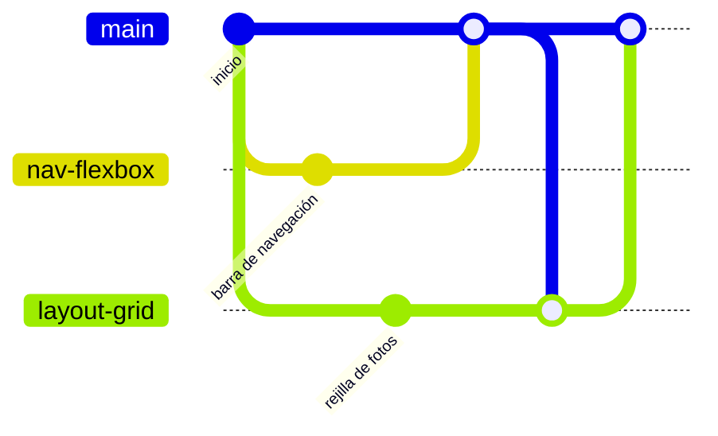

# 🎨 diw-santa-toral

Práctica de maquetación web (UT1) de **Diseño de Interfaces Web**.

> [!IMPORTANT]
> **Entrega: martes 10/11 a las 23:59**

---

## 📌 Reglas

1. Nunca se trabaja en `main`: cada tarea, en su rama.
2. Todo entra en `main` por pull request aprobado por otro compañero.
3. Nunca `git push --force`. Si algo falla, se pregunta al grupo.
4. Cada uno trabaja en sus archivos. Lo compartido (`:root`, estructura base) lo toca una sola persona.
5. No se suben imágenes sin optimizar (WebP, menos de 300 KB) ni configuración del editor.

---

## 🔄 Flujo de cada tarea

**1. Ponerse al día.** Antes de empezar nada, trae lo último de `main`:
```bash
git switch main
git pull
```

**2. Crear tu rama.** Con un nombre que diga qué vas a hacer (`nav-flexbox`, `layout-grid`…):
```bash
git switch -c nombre-tarea
```

**3. Trabajar.** Haz los cambios y comprueba en el navegador que todo se ve bien.

**4. Revisar qué vas a guardar.** Mira la lista y asegúrate de que no se cuela nada raro:
```bash
git status
```

**5. Guardar los cambios.** Commits pequeños, con un mensaje que diga qué cambia:
```bash
git add .
git commit -m "Añade la barra de navegación"
```

**6. Subir la rama.** La primera vez con `-u`; después basta con `git push`:
```bash
git push -u origin nombre-tarea
```

**7. Abrir el pull request.** En GitHub aparecerá el botón **Compare & pull request**. Describe el cambio y elige a un compañero en **Reviewers**.

**8. Revisión.** El compañero mira el cambio en **Files changed** y lo aprueba con **Review changes → Approve**.

**9. Fusionar.** Quien abrió el pull request pulsa **Merge pull request**.

**10. Limpiar en local.** Vuelve a `main`, trae lo fusionado y borra la rama:
```bash
git switch main
git pull
git branch -d nombre-tarea
```

> [!TIP]
> Si no sabes en qué estado estás, `git status` casi siempre lo explica.

---

<details>
<summary><strong>🔁 Mi rama lleva tiempo abierta y main ha cambiado</strong></summary>

<br>

Trae lo nuevo de `main` a tu rama para no quedarte atrás y evitar conflictos grandes al final:

```bash
git switch main
git pull
git switch mi-rama
git merge main
```

</details>

<details>
<summary><strong>🆘 Si algo sale mal</strong></summary>

<br>

| Situación | Qué hacer |
|---|---|
| He hecho cambios en `main` sin querer (sin commit) | `git switch -c nombre-rama`: los cambios se van a la rama nueva. |
| He hecho commit en `main` sin querer (sin push) | `git switch -c nombre-rama` para llevarte el commit, y avisa al grupo antes de tocar `main`. |
| El push es rechazado | `git pull` y luego `git push`. |
| Hay un conflicto | Abre el archivo, decide con tu compañero qué se queda, borra las marcas `<<<<<<<`, `=======` y `>>>>>>>`, y haz `git add` + `git commit`. Para cancelar: `git merge --abort`. |

</details>

<details>
<summary><strong>🌿 Cómo funcionan las ramas</strong></summary>

<br>

- **`main` es la versión buena**: la que se entrega. Solo cambia cuando se fusiona un pull request revisado.
- **Una rama es una copia paralela** que nace de `main` en el momento de crearla. Lo que hagas en ella no afecta a `main` ni a los demás.
- **Por eso se hace `git pull` antes de crearla**: para que nazca de la versión más reciente y no de una antigua.
- **El pull request es una propuesta**: "quiero meter estos cambios en `main`". Otro compañero lo revisa antes de que entre.
- **Tras la fusión la rama ya no hace falta**: su trabajo vive en `main`, y se borra.



En el diagrama, cada uno trabaja en su rama a la vez. `nav-flexbox` entra primero en `main`. Después, `layout-grid` trae esos cambios (`git merge main`) antes de entrar también.

</details>
