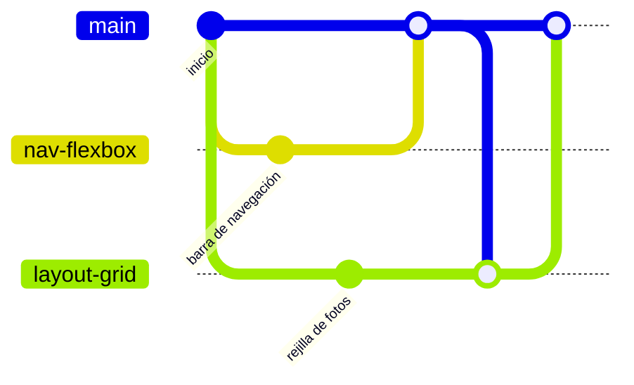

# 🎨 diw-santa-toral

Práctica de maquetación web (UT1) de **Diseño de Interfaces Web**: la web **Viajes & Wallpapers**, con fondos de pantalla de Japón, China, Colombia, Perú y España. Grupo: Asier Toral, Santiago Santa y Julinho Ghair.

**Contenido:** [Estructura del proyecto](#-estructura-del-proyecto) · [Empezar desde cero (VS Code)](#-empezar-desde-cero-vs-code) · [Reglas](#-reglas) · [Flujo de cada tarea](#-flujo-de-cada-tarea) · [Créditos de las imágenes](#-créditos-de-las-imágenes)

---

## 📁 Estructura del proyecto

Es una web estática en HTML y CSS, sin nada que instalar: basta con abrir `index.html` en el navegador (o con Live Server).

```text
├── index.html  fotos.html  nosotros.html  contacto.html   páginas del menú
├── aviso-legal.html  privacidad.html  cookies.html         páginas legales (enlaces del pie)
├── plantilla.html                                          base para crear páginas nuevas
├── css/estilos.css                                         la única hoja de estilos
├── img/                                                    fotos de las galerías (WebP)
│   └── icono/                                              iconos SVG y favicon
├── README.md                                               esta guía
└── .gitignore                                              lo que Git no debe subir
```

| Archivo o carpeta | Para qué está | Cuándo hay que tocarlo |
|---|---|---|
| `index.html` | La portada: presentación, una tarjeta por destino (la de Perú con la etiqueta «Novedad»), temáticas, tabla de colecciones y mapa. | Al añadir o cambiar un destino: su tarjeta, su temática y su fila de la tabla. |
| `fotos.html` | Las cinco galerías de 12 fotos, con el resumen y el índice de galerías arriba. | Al añadir fotos o una galería nueva: seguid el comentario de la galería de Japón. |
| `nosotros.html` | Quiénes somos, nuestra historia, el equipo y un glosario. | Si cambia el equipo o el texto sobre nosotros. |
| `contacto.html` | Correo y formulario de contacto. Es una demostración: no envía nada. | Para cambiar los campos del formulario. |
| `aviso-legal.html`, `privacidad.html`, `cookies.html` | Las páginas legales que enlaza el pie, creadas a partir de la plantilla. | Si la web empieza a usar un servicio externo nuevo (otra fuente, otro mapa, cookies) o cambia algo de lo que cuentan. |
| `plantilla.html` | La plantilla común (paso 8 del enunciado): cabecera, menú y pie, con el contenido vacío. | Para crear una página, copiadla. Si cambia el menú o el pie, cambiadlo aquí y en todas las páginas. |
| `css/estilos.css` | Todos los estilos, con un índice al principio. Colores, fuentes, tamaños y espacios salen de las variables del `:root`. | Para cualquier cambio visual. Cambiad la variable antes que un valor suelto, y nada de CSS dentro del HTML. |
| `img/` | Las fotos, en WebP y numeradas. Por galería: **Japón** 25, 27 y 55–64 · **China** 1–6, 9, 10, 12 y 52–54 · **Colombia** 13–15, 22 y 65–72 · **Perú** 28–39 · **España** 40–51. La `8.webp` es el fondo de la presentación de Fotos (se pone desde el CSS). Las tarjetas de la portada reutilizan una foto de cada galería. | Al añadir fotos: en WebP, de menos de 300 KB y con un número nuevo (del 73 en adelante). No renombréis las que hay, porque las páginas las enlazan por su nombre. |
| `img/icono/` | Iconos SVG del mismo estilo: uno por galería (`brujula`, `capas`, `paneles`, `montana`, `castillo`), el check de «Qué incluye» (`check.svg`, desde el CSS) y el icono de la pestaña (`favicon.svg`). | Al añadir una galería, añadid su icono con el mismo estilo. |
| `README.md` | Esta guía: estructura, reglas, flujo de trabajo con Git y créditos de las imágenes. | Si cambia la estructura o las reglas, o si añadís una foto que no es nuestra. |
| `.gitignore` | Lo que Git no debe subir: la configuración de los editores (`.vscode/`, `.idea/`, `*.iml`), archivos del sistema (`.DS_Store`) y carpetas de herramientas (`node_modules/`, `dist/`). | Si alguien usa una herramienta que genera archivos que no deben subirse. |

La marca de Git `ut0-original` guarda la web tal como quedó al terminar la UT0, antes de aplicar el diseño de la UT1.

---

## 🚀 Empezar desde cero (VS Code)

Si nunca has usado Git ni GitHub en equipo, empieza aquí. Los pasos 1 a 5 se hacen **una sola vez**; el paso 6 es lo que harás en cada tarea.

Los nombres de botones y menús van en inglés, que es como viene VS Code; entre paréntesis, cómo se ven si lo tienes en español. Junto a cada paso está el comando de terminal equivalente, por si lo prefieres (en VS Code: menú **Terminal → New Terminal**).

### 1. Qué necesitas

| Qué | Cómo comprobarlo o conseguirlo |
|---|---|
| **Git** | Abre una terminal y escribe `git --version`. Si responde algo como `git version 2.47.0`, ya lo tienes. Si no: **Windows**, descárgalo de https://git-scm.com/download/win e instálalo con las opciones por defecto · **macOS**, al escribir `git --version` el sistema ofrece instalar las *Command Line Tools*: acepta (o usa `brew install git`) · **Linux**, con el gestor de paquetes (`sudo apt install git`, `sudo dnf install git` o `sudo pacman -S git`). |
| **Cuenta de GitHub** | Regístrate en https://github.com/signup si no tienes. |
| **VS Code** | Descárgalo de https://code.visualstudio.com/. |
| **Live Server** | En VS Code, abre el panel de extensiones (icono de cuadrados en la barra de la izquierda, o `Ctrl+Shift+X`), busca «Live Server» (de Ritwick Dey) y pulsa **Install** (Instalar). |

Después de instalar Git, cierra y vuelve a abrir VS Code para que lo detecte.

### 2. Aceptar la invitación al repo

Te llegará un correo de GitHub con la invitación. También puedes aceptarla directamente aquí, con tu cuenta iniciada: https://github.com/Karsu1411/diw-santa-toral/invitations → **Accept invitation**. Sin este paso podrás ver el repo, pero no subir cambios.

### 3. Tu nombre y tu correo en Git

Cada commit lleva un nombre y un correo, y en un repo público los ve cualquiera. Usa tu **dirección privada de GitHub** en lugar de tu correo personal:

1. En GitHub: tu foto (arriba a la derecha) → **Settings** → **Emails**.
2. Marca **Keep my email addresses private**. Debajo aparece tu dirección privada, con esta forma: `12345678+tuusuario@users.noreply.github.com`.
3. Marca también **Block command line pushes that expose my email**, para que GitHub te avise si se te escapa el personal.

Luego, en la terminal de VS Code (una sola vez en tu ordenador):

```bash
git config --global user.name "Tu Nombre"
git config --global user.email "12345678+tuusuario@users.noreply.github.com"
```

Compruébalo con `git config user.email`.

### 4. Clonar el repo y abrirlo

1. En VS Code pulsa `Ctrl+Shift+P` (en macOS, `Cmd+Shift+P`) y escribe **Git: Clone** (Git: Clonar).
2. Elige **Clone from GitHub** (Clonar desde GitHub). La primera vez, VS Code te pide permiso para iniciar sesión: pulsa **Allow** (Permitir), se abre el navegador, autoriza a VS Code en GitHub y vuelve.
3. Escribe `Karsu1411/diw-santa-toral` y elígelo de la lista.
4. Elige la carpeta donde guardarlo (por ejemplo, `Documentos/daw`). VS Code crea dentro la carpeta `diw-santa-toral`.
5. Cuando pregunte *Would you like to open the cloned repository?*, pulsa **Open** (Abrir).

Si todo ha ido bien, abajo a la izquierda, en la barra de estado, verás la rama en la que estás:

```text
 ⎇ main   ↻
```

En terminal: `git clone https://github.com/Karsu1411/diw-santa-toral.git` y después `code diw-santa-toral`.

### 5. Ver la web

Abre `index.html` y pulsa **Go Live** abajo a la derecha, en la barra de estado (o clic derecho en el archivo → **Open with Live Server**). La web se abre en el navegador y se recarga sola cada vez que guardas (`Ctrl+S`).

### 6. Trabajar en una tarea desde VS Code

Todo cambio va en su rama y entra en `main` por pull request ([Reglas](#-reglas)): GitHub no acepta subir nada directamente a `main`. Estos son los pasos del [Flujo de cada tarea](#-flujo-de-cada-tarea), hechos desde la interfaz de VS Code:

| Paso | En VS Code | En terminal |
|---|---|---|
| **Ponerse al día** | Asegúrate de estar en `main` (barra de estado). Abre el panel **Source Control** (Control de código fuente; icono de ramas a la izquierda, o `Ctrl+Shift+G`) → menú `···` → **Pull** (Incorporación de cambios). | `git switch main` y `git pull` |
| **Crear tu rama** | Clic en `⎇ main` en la barra de estado → **Create new branch...** (Crear nueva rama...) → escribe el nombre (`menu-movil`, `texto-nosotros`…) y pulsa `Enter`. La barra de estado pasa a mostrar `⎇ menu-movil`. | `git switch -c menu-movil` |
| **Hacer los cambios** | Edita y guarda. En Source Control aparece cada archivo cambiado bajo **Changes** (Cambios); al hacer clic en uno ves qué has cambiado. | `git status` |
| **Guardar (commit)** | Escribe en la caja **Message** (Mensaje) qué cambia, en presente: «Añade el menú en móvil». Pulsa **Commit** (Confirmar). Si VS Code pregunta si quieres incluir todos los cambios, responde **Yes** (Sí). | `git add .` y `git commit -m "Añade el menú en móvil"` |
| **Publicar la rama** | Pulsa **Publish Branch** (Publicar rama) en Source Control. Los commits siguientes de esa rama se suben con **Sync Changes** (Sincronizar cambios). | `git push -u origin menu-movil` (después, `git push`) |
| **Abrir el pull request** | En GitHub, en la página del repo, aparece el aviso **Compare & pull request**: sigue los pasos 7 a 9 del [flujo](#-flujo-de-cada-tarea). | `gh pr create` (si tienes GitHub CLI) |

### 7. Después de que se fusione tu pull request

Vuelve a `main` y trae lo fusionado: clic en `⎇ menu-movil` en la barra de estado → elige `main` → Source Control → `···` → **Pull**. La rama de GitHub se borra sola al fusionar; la tuya local puedes borrarla en Source Control → `···` → **Branch** → **Delete Branch...** (Rama → Eliminar rama...). Es el paso 10 del [flujo](#-flujo-de-cada-tarea).

### 8. Errores típicos del principio

| Qué pasa | Qué hacer |
|---|---|
| **No aparece «Git: Clone» o Source Control dice *Download Git*** | VS Code no encuentra Git. Instálalo (paso 1) y cierra y abre VS Code. |
| **Pide usuario y contraseña** | GitHub ya no acepta la contraseña de tu cuenta. Cancela y deja que VS Code inicie sesión con el navegador (paso 4). Si aun así insiste, en terminal: `gh auth login` (GitHub CLI) o crea un token en GitHub → Settings → Developer settings. |
| **GitHub rechaza el push a `main`** (*protected branch*) | Es lo esperado: `main` está protegida. Crea una rama desde donde estás (barra de estado → **Create new branch...**), publícala y abre el pull request. Más casos en el desplegable «🆘 Si algo sale mal», más abajo. |
| **Conflicto al actualizar** | VS Code marca los archivos en conflicto en **Merge Changes** y, dentro del archivo, ofrece **Accept Current Change**, **Accept Incoming Change** o **Accept Both Changes**. Decide con el compañero qué se queda, guarda y haz commit. Más detalle en «🆘 Si algo sale mal», más abajo. |

---

## 📌 Reglas

1. Nunca se trabaja directamente en `main`: cada cambio, también los pequeños (un texto, un color, una foto), va en su rama.
2. Todo entra en `main` por pull request aprobado por otro compañero. GitHub lo exige: `main` está protegida y no acepta pushes directos.
3. Nunca `git push --force`. Si algo falla, se pregunta al grupo.
4. Cada uno trabaja en sus archivos. Lo compartido (`:root`, estructura base) lo toca una sola persona.
5. No se suben imágenes sin optimizar (WebP, menos de 300 KB) ni configuración del editor.

---

## 🔄 Flujo de cada tarea

Todos los cambios, grandes o pequeños, siguen estos pasos: siempre con tu rama y tu pull request.

**1. Ponerse al día.** Antes de empezar nada, trae lo último de `main`:
```bash
git switch main
git pull
```

**2. Crear tu rama.** Con un nombre que diga qué vas a hacer (`nav-flexbox`, `layout-grid`…):
```bash
git switch -c nombre-tarea
```

**3. Trabajar.** Haz los cambios y comprueba en el navegador que todo se ve bien.

**4. Revisar qué vas a guardar.** Mira la lista y asegúrate de que no se cuela nada raro:
```bash
git status
```

**5. Guardar los cambios.** Commits pequeños, con un mensaje que diga qué cambia:
```bash
git add .
git commit -m "Añade la barra de navegación"
```

**6. Subir la rama.** La primera vez con `-u`; después basta con `git push`:
```bash
git push -u origin nombre-tarea
```

**7. Abrir el pull request.** En GitHub aparecerá el botón **Compare & pull request**. Describe el cambio y elige a un compañero en **Reviewers**.

**8. Revisión.** El compañero mira el cambio en **Files changed** y lo aprueba con **Review changes → Approve**.

**9. Fusionar.** Quien abrió el pull request pulsa **Merge pull request**.

**10. Limpiar en local.** Vuelve a `main`, trae lo fusionado y borra la rama:
```bash
git switch main
git pull
git branch -d nombre-tarea
```

> [!TIP]
> Si no sabes en qué estado estás, `git status` casi siempre lo explica.

---

<details>
<summary><strong>🔁 Mi rama lleva tiempo abierta y main ha cambiado</strong></summary>

<br>

Trae lo nuevo de `main` a tu rama para no quedarte atrás y evitar conflictos grandes al final:

```bash
git switch main
git pull
git switch mi-rama
git merge main
```

</details>

<details>
<summary><strong>🆘 Si algo sale mal</strong></summary>

<br>

| Situación | Qué hacer |
|---|---|
| He hecho cambios en `main` sin querer (sin commit) | `git switch -c nombre-rama`: los cambios se van a la rama nueva. |
| He hecho commit en `main` sin querer | `git switch -c nombre-rama` para llevarte el commit a una rama y abre el pull request desde ahí. Tu `main` local se queda por delante de GitHub: avisa al grupo antes de arreglarlo. |
| GitHub rechaza mi push a `main` | Es la protección de `main`: sube tu trabajo a una rama y abre un pull request. |
| El push es rechazado | `git pull` y luego `git push`. |
| Hay un conflicto | Abre el archivo, decide con tu compañero qué se queda, borra las marcas `<<<<<<<`, `=======` y `>>>>>>>`, y haz `git add` + `git commit`. Para cancelar: `git merge --abort`. |

</details>

<details>
<summary><strong>🌿 Cómo funcionan las ramas</strong></summary>

<br>

- **`main` es la versión buena**: la que se entrega. Solo cambia cuando se fusiona un pull request revisado.
- **Una rama es una copia paralela** que nace de `main` en el momento de crearla. Lo que hagas en ella no afecta a `main` ni a los demás.
- **Por eso se hace `git pull` antes de crearla**: para que nazca de la versión más reciente y no de una antigua.
- **El pull request es una propuesta**: "quiero meter estos cambios en `main`". Otro compañero lo revisa antes de que entre.
- **Tras la fusión la rama ya no hace falta**: su trabajo vive en `main`, y se borra.



En el diagrama, cada uno trabaja en su rama a la vez. `nav-flexbox` entra primero en `main`. Después, `layout-grid` trae esos cambios (`git merge main`) antes de entrar también.

</details>

---

## 📷 Créditos de las imágenes

La web simula una colección propia. Las fotos de Perú, España y parte de las de Japón, China y Colombia son de Unsplash y se usan según su [licencia](https://unsplash.com/license); estos son sus autores. Si añadís una foto que no sea nuestra, apuntad aquí su archivo, su autor y su enlace.

### Japón

| Archivo | Foto | Autor | Enlace |
|---|---|---|---|
| `img/55.webp` | Pagoda de Kiyomizu al atardecer, Kioto | [yomogi](https://unsplash.com/@yomogi_86?utm_source=viajes_wallpapers&utm_medium=referral) | [Unsplash](https://unsplash.com/photos/a-group-of-people-standing-in-front-of-a-building-fNSmm92MMs4?utm_source=viajes_wallpapers&utm_medium=referral) |
| `img/56.webp` | Atardecer rosa y morado en Kioto | [Andre Benz](https://unsplash.com/@trapnation?utm_source=viajes_wallpapers&utm_medium=referral) | [Unsplash](https://unsplash.com/photos/gray-roofed-temple-surrounded-with-trees-axQXVkrUASg?utm_source=viajes_wallpapers&utm_medium=referral) |
| `img/57.webp` | Pagoda con cielo rosado, Kiyomizu-dera | [silversea](https://unsplash.com/@silversea?utm_source=viajes_wallpapers&utm_medium=referral) | [Unsplash](https://unsplash.com/photos/a-tall-building-sitting-on-top-of-a-lush-green-hillside-0_BaOMDIIkI?utm_source=viajes_wallpapers&utm_medium=referral) |
| `img/58.webp` | Calle de Kioto al anochecer | [Zhuojun Yu](https://unsplash.com/@heebase?utm_source=viajes_wallpapers&utm_medium=referral) | [Unsplash](https://unsplash.com/photos/a-car-driving-down-a-street-next-to-tall-buildings-slh5jopdM4g?utm_source=viajes_wallpapers&utm_medium=referral) |
| `img/59.webp` | Sensō-ji con cerezos, Tokio | [Ramon Buçard](https://unsplash.com/@ramonbucard?utm_source=viajes_wallpapers&utm_medium=referral) | [Unsplash](https://unsplash.com/photos/a-japanese-temple-bustling-with-activity-and-cherry-blossoms-4Sr74udypAY?utm_source=viajes_wallpapers&utm_medium=referral) |
| `img/60.webp` | Puente rojo del río Meguro de noche, Tokio | [MacroLingo LLC](https://unsplash.com/@macrolingo?utm_source=viajes_wallpapers&utm_medium=referral) | [Unsplash](https://unsplash.com/photos/people-on-a-red-bridge-under-cherry-blossoms-at-night-iSC-TMwElw8?utm_source=viajes_wallpapers&utm_medium=referral) |
| `img/61.webp` | Farolillos de Omoide Yokochō, Shinjuku | [Pema G. Lama](https://unsplash.com/@peemaglama?utm_source=viajes_wallpapers&utm_medium=referral) | [Unsplash](https://unsplash.com/photos/red-lanterns-in-shinjuku-city-alley-6cfK0SEtpbY?utm_source=viajes_wallpapers&utm_medium=referral) |
| `img/62.webp` | Templo iluminado, Tokio | [Jakub Tomasik](https://unsplash.com/@jakubeq?utm_source=viajes_wallpapers&utm_medium=referral) | [Unsplash](https://unsplash.com/photos/japanese-temple-illuminated-with-lanterns-at-night-GRJ4CUSNhR4?utm_source=viajes_wallpapers&utm_medium=referral) |
| `img/63.webp` | Callejón con farolillos, Shibuya | [mos design](https://unsplash.com/@mosdesign?utm_source=viajes_wallpapers&utm_medium=referral) | [Unsplash](https://unsplash.com/photos/a-narrow-alley-with-lanterns-hanging-from-the-ceiling-wGoO-KqFmDM?utm_source=viajes_wallpapers&utm_medium=referral) |
| `img/64.webp` | Pagoda Chureito y el monte Fuji | [Spenser Sembrat](https://unsplash.com/@spensersembrat?utm_source=viajes_wallpapers&utm_medium=referral) | [Unsplash](https://unsplash.com/photos/a-pagoda-with-a-mountain-in-the-background-vlUceP_3T6I?utm_source=viajes_wallpapers&utm_medium=referral) |

### China

| Archivo | Foto | Autor | Enlace |
|---|---|---|---|
| `img/52.webp` | Skyline de Shanghái al atardecer | [zhang kaiyv](https://unsplash.com/@zhangkaiyv?utm_source=viajes_wallpapers&utm_medium=referral) | [Unsplash](https://unsplash.com/photos/cn-tower-toronto-canada-PoV-nZLoupM?utm_source=viajes_wallpapers&utm_medium=referral) |
| `img/53.webp` | Río Li en Yangshuo, Guilin | [YMA](https://unsplash.com/@anhsy?utm_source=viajes_wallpapers&utm_medium=referral) | [Unsplash](https://unsplash.com/photos/a-bunch-of-boats-that-are-sitting-in-the-water-m1l8kJOVYoo?utm_source=viajes_wallpapers&utm_medium=referral) |
| `img/54.webp` | Montañas kársticas de Guilin | [Yifan Cong](https://unsplash.com/@congyf?utm_source=viajes_wallpapers&utm_medium=referral) | [Unsplash](https://unsplash.com/photos/karst-mountains-in-golden-hour-light-PR8kWkmqpOo?utm_source=viajes_wallpapers&utm_medium=referral) |

### Colombia

| Archivo | Foto | Autor | Enlace |
|---|---|---|---|
| `img/65.webp` | Calle de Cartagena con buganvillas | [Ricardo Gomez Angel](https://unsplash.com/@rgaleriacom?utm_source=viajes_wallpapers&utm_medium=referral) | [Unsplash](https://unsplash.com/photos/multicolored-houses-L6T_6Rp2iEk?utm_source=viajes_wallpapers&utm_medium=referral) |
| `img/66.webp` | Balcones con flores, Cartagena | [Jimmy Hu](https://unsplash.com/@woomantsing?utm_source=viajes_wallpapers&utm_medium=referral) | [Unsplash](https://unsplash.com/photos/a-row-of-colorful-buildings-with-flowers-growing-on-the-balconies-u1KDpj425VM?utm_source=viajes_wallpapers&utm_medium=referral) |
| `img/67.webp` | Palenqueras, Cartagena | [Tannia Aviles](https://unsplash.com/@tanniaaviles?utm_source=viajes_wallpapers&utm_medium=referral) | [Unsplash](https://unsplash.com/photos/a-group-of-women-in-colorful-dresses-standing-next-to-each-other-W4_dXeeNAXw?utm_source=viajes_wallpapers&utm_medium=referral) |
| `img/68.webp` | Calle con sombrillas de colores, Cartagena | [Luis Desiro](https://unsplash.com/@luisdesiro?utm_source=viajes_wallpapers&utm_medium=referral) | [Unsplash](https://unsplash.com/photos/a-group-of-colorful-umbrellas-swing-from-a-building-rRHD5-FXt9g?utm_source=viajes_wallpapers&utm_medium=referral) |
| `img/69.webp` | Muralla de Cartagena al atardecer | [Luis Desiro](https://unsplash.com/@luisdesiro?utm_source=viajes_wallpapers&utm_medium=referral) | [Unsplash](https://unsplash.com/photos/a-stone-wall-with-a-city-in-the-background-sVui3lJZCJE?utm_source=viajes_wallpapers&utm_medium=referral) |
| `img/70.webp` | Pereira al atardecer | [Cristhian Valencia](https://unsplash.com/@vlycser?utm_source=viajes_wallpapers&utm_medium=referral) | [Unsplash](https://unsplash.com/photos/white-and-brown-concrete-building-during-daytime-bF5Lj0xB6D4?utm_source=viajes_wallpapers&utm_medium=referral) |
| `img/71.webp` | Medellín de noche | [Joel Duncan](https://unsplash.com/@joelduncan?utm_source=viajes_wallpapers&utm_medium=referral) | [Unsplash](https://unsplash.com/photos/city-buildings-during-sunset-Iqa-WlbNjqs?utm_source=viajes_wallpapers&utm_medium=referral) |
| `img/72.webp` | Parque Tayrona al atardecer | [David Restrepo](https://unsplash.com/@davidremu_?utm_source=viajes_wallpapers&utm_medium=referral) | [Unsplash](https://unsplash.com/photos/silhouette-of-people-standing-near-brown-wooden-gazebo-during-sunset-dMS50KQzFVc?utm_source=viajes_wallpapers&utm_medium=referral) |

### Perú

| Archivo | Foto | Autor | Enlace |
|---|---|---|---|
| `img/28.webp` | Machu Picchu al amanecer | [Sebastian Tapia Huerta](https://unsplash.com/@sebastiantapiahuerta?utm_source=viajes_wallpapers&utm_medium=referral) | [Unsplash](https://unsplash.com/photos/maccu-pichu-peru-5qba-p9ahTE?utm_source=viajes_wallpapers&utm_medium=referral) |
| `img/29.webp` | Machu Picchu con luz de la mañana | [Xiyuan Du](https://unsplash.com/@alb_7th?utm_source=viajes_wallpapers&utm_medium=referral) | [Unsplash](https://unsplash.com/photos/a-large-rocky-landscape-bFPwdDIQ0LQ?utm_source=viajes_wallpapers&utm_medium=referral) |
| `img/30.webp` | Montaña de Colores | [McKayla Crump](https://unsplash.com/@funkmastacrump?utm_source=viajes_wallpapers&utm_medium=referral) | [Unsplash](https://unsplash.com/photos/mountain-under-gray-clouds-hjanvZlqoB8?utm_source=viajes_wallpapers&utm_medium=referral) |
| `img/31.webp` | Mujer y niña con una llama en la Montaña de Colores | [Ioana Mohanu](https://unsplash.com/@iua713?utm_source=viajes_wallpapers&utm_medium=referral) | [Unsplash](https://unsplash.com/photos/woman-in-red-and-blue-dress-riding-brown-horse-during-daytime-VdpChUDXDT8?utm_source=viajes_wallpapers&utm_medium=referral) |
| `img/32.webp` | Iglesia de la Compañía, Cusco | [Hongbin](https://unsplash.com/@hbsun2013?utm_source=viajes_wallpapers&utm_medium=referral) | [Unsplash](https://unsplash.com/photos/a-large-building-with-a-clock-tower-on-top-of-it-lT4PjdUl70U?utm_source=viajes_wallpapers&utm_medium=referral) |
| `img/33.webp` | Cúpulas de Cusco al atardecer | [Hongbin](https://unsplash.com/@hbsun2013?utm_source=viajes_wallpapers&utm_medium=referral) | [Unsplash](https://unsplash.com/photos/a-view-of-a-city-from-the-top-of-a-hill-QDthBGlmeFE?utm_source=viajes_wallpapers&utm_medium=referral) |
| `img/34.webp` | Tejados de Cusco | [Mauro Lima](https://unsplash.com/@limamauro23?utm_source=viajes_wallpapers&utm_medium=referral) | [Unsplash](https://unsplash.com/photos/a-large-city-with-many-buildings-bz4Bu_SAmz0?utm_source=viajes_wallpapers&utm_medium=referral) |
| `img/35.webp` | Calle con tejidos en Cusco | [NINA PASCAL](https://unsplash.com/@nina1795?utm_source=viajes_wallpapers&utm_medium=referral) | [Unsplash](https://unsplash.com/photos/people-walking-on-street-during-daytime-G-ZdZQyoeWg?utm_source=viajes_wallpapers&utm_medium=referral) |
| `img/36.webp` | Arequipa y el volcán Misti | [Megan Kotlus](https://unsplash.com/@mkotlus07?utm_source=viajes_wallpapers&utm_medium=referral) | [Unsplash](https://unsplash.com/photos/white-and-brown-concrete-building-near-green-trees-and-mountain-during-daytime-XHoVvW8VkzY?utm_source=viajes_wallpapers&utm_medium=referral) |
| `img/37.webp` | Nevado al atardecer en Huaraz | [ÁLVARO MENDOZA](https://unsplash.com/@a56?utm_source=viajes_wallpapers&utm_medium=referral) | [Unsplash](https://unsplash.com/photos/snow-capped-mountains-bathed-in-sunset-light-gchDEzu3gxg?utm_source=viajes_wallpapers&utm_medium=referral) |
| `img/38.webp` | Atardecer en Miraflores, Lima | [Willian Justen de Vasconcellos](https://unsplash.com/@willianjusten?utm_source=viajes_wallpapers&utm_medium=referral) | [Unsplash](https://unsplash.com/photos/calm-sea-under-clear-blue-sky-during-sunset-YIAvaAlAqWk?utm_source=viajes_wallpapers&utm_medium=referral) |
| `img/39.webp` | Llama en el altiplano | [Andy Salazar](https://unsplash.com/@andycusco?utm_source=viajes_wallpapers&utm_medium=referral) | [Unsplash](https://unsplash.com/photos/a-couple-of-llamas-standing-on-top-of-a-mountain-tnJg18m9mag?utm_source=viajes_wallpapers&utm_medium=referral) |

### España

| Archivo | Foto | Autor | Enlace |
|---|---|---|---|
| `img/40.webp` | La Giralda y la catedral de Sevilla | [Henrique Ferreira](https://unsplash.com/@rickpsd?utm_source=viajes_wallpapers&utm_medium=referral) | [Unsplash](https://unsplash.com/photos/seville-cathedral-and-giralda-in-seville-62QRdDoe44M?utm_source=viajes_wallpapers&utm_medium=referral) |
| `img/41.webp` | Arcos de la Plaza de España, Sevilla | [Tânia Mousinho](https://unsplash.com/@shotsbytania?utm_source=viajes_wallpapers&utm_medium=referral) | [Unsplash](https://unsplash.com/photos/a-large-brick-building-with-pillars-dMi3pqiqhsw?utm_source=viajes_wallpapers&utm_medium=referral) |
| `img/42.webp` | Cúpula del Real Alcázar de Sevilla | [Akshay Nanavati](https://unsplash.com/@anphotos?utm_source=viajes_wallpapers&utm_medium=referral) | [Unsplash](https://unsplash.com/photos/dome-building-interior-QDrquqtF98k?utm_source=viajes_wallpapers&utm_medium=referral) |
| `img/43.webp` | Baños del Real Alcázar de Sevilla | [David Hertle](https://unsplash.com/@usa_reiseblogger_de?utm_source=viajes_wallpapers&utm_medium=referral) | [Unsplash](https://unsplash.com/photos/brown-dome-ceiling-hallway-8HAhmMk9HJI?utm_source=viajes_wallpapers&utm_medium=referral) |
| `img/44.webp` | La Alhambra al atardecer | [Jorge Fernández Salas](https://unsplash.com/@jorgefdezsalas?utm_source=viajes_wallpapers&utm_medium=referral) | [Unsplash](https://unsplash.com/photos/brown-concrete-building-near-green-trees-during-daytime-C7MUgJowo8s?utm_source=viajes_wallpapers&utm_medium=referral) |
| `img/45.webp` | Arco de la Alhambra | [Austin Gardner](https://unsplash.com/@formativeadventures?utm_source=viajes_wallpapers&utm_medium=referral) | [Unsplash](https://unsplash.com/photos/brown-and-white-building-under-clear-blue-sky-during-daytime-7fElVDKXLoQ?utm_source=viajes_wallpapers&utm_medium=referral) |
| `img/46.webp` | Reflejo en la Alhambra | [Hari Nandakumar](https://unsplash.com/@hariprasad000?utm_source=viajes_wallpapers&utm_medium=referral) | [Unsplash](https://unsplash.com/photos/people-standing-beside-closed-french-doors-during-day-YU8B9FA886g?utm_source=viajes_wallpapers&utm_medium=referral) |
| `img/47.webp` | El Tibidabo al atardecer, Barcelona | [Ken Cheung](https://unsplash.com/@kencheungphoto?utm_source=viajes_wallpapers&utm_medium=referral) | [Unsplash](https://unsplash.com/photos/cathedral-on-hill-VbLTNceBTFE?utm_source=viajes_wallpapers&utm_medium=referral) |
| `img/48.webp` | Barcelona desde el Turó de la Rovira | [MINSUN KIM](https://unsplash.com/@maroonsun?utm_source=viajes_wallpapers&utm_medium=referral) | [Unsplash](https://unsplash.com/photos/aerial-photography-of-buildings-FuaNmJPLAHg?utm_source=viajes_wallpapers&utm_medium=referral) |
| `img/49.webp` | Montjuïc al atardecer, Barcelona | [ian kelsall](https://unsplash.com/@iankelsall1?utm_source=viajes_wallpapers&utm_medium=referral) | [Unsplash](https://unsplash.com/photos/people-sitting-on-bench-near-building-during-sunset-dXDHJ1wXEL0?utm_source=viajes_wallpapers&utm_medium=referral) |
| `img/50.webp` | Playa de Barcelona al atardecer | [Krisztián Korhetz](https://unsplash.com/@kkorhetz?utm_source=viajes_wallpapers&utm_medium=referral) | [Unsplash](https://unsplash.com/photos/barcelonas-beachfront-at-sunset-is-gorgeous-2U2lIubFs6A?utm_source=viajes_wallpapers&utm_medium=referral) |
| `img/51.webp` | Columnas de la Plaza de España, Sevilla | [Mr Mulligan](https://unsplash.com/@theonephoto?utm_source=viajes_wallpapers&utm_medium=referral) | [Unsplash](https://unsplash.com/photos/a-large-building-with-columns-and-a-clock-tower-cgkFtkpifrA?utm_source=viajes_wallpapers&utm_medium=referral) |
